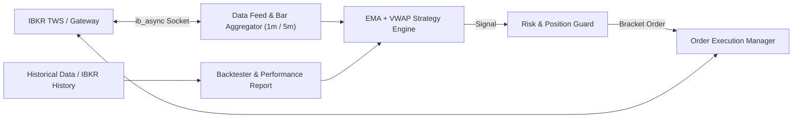

# NQ Futures Short-Term Trading Bot (IBKR + Python)

A modular, event-driven Python trading bot for **E-mini Nasdaq-100 (`NQ`)** and **Micro E-mini Nasdaq-100 (`MNQ`)** futures on Interactive Brokers (TWS / IB Gateway) using `ib_async` (the actively maintained successor to `ib_insync`).

---

## Architecture Overview

---

## Strategy Design: Intraday EMA + VWAP Pullback & Crossover

Designed for **1-minute or 5-minute bars** during Regular Trading Hours (RTH: 09:30–16:00 ET):

1. **Indicators**:
   - **Session VWAP**: Anchored to the start of the trading session (09:30 ET), acting as the primary institutional trend filter.
   - **Fast EMA (e.g., 9 EMA)** & **Slow EMA (e.g., 21 EMA)**: Momentum and dynamic pullback levels.
   - **ATR (14-period)** & **RSI (14-period)**: Volatility-based stops and overbought/oversold filters.
2. **Entry Rules**:
   - **Long Setup**: Price is above Session VWAP, Fast EMA > Slow EMA, and price either:
     - *Crossover mode*: Crosses above Fast/Slow EMA with volume above average, OR
     - *Pullback mode*: Pulls back to touch/test the Fast EMA (9) or Slow EMA (21) while staying above VWAP, then closes back above the Fast EMA (bullish rejection candle).
   - **Short Setup**: Mirror opposite below Session VWAP (Fast EMA < Slow EMA, bearish rejection off EMA pullback).
3. **Exit & Risk Rules (Server-Side Bracket Orders)**:
   - **Stop Loss**: Fixed ticks/points or `1.5x ATR` (configurable, e.g., 15–25 points on NQ).
   - **Take Profit**: Configurable Risk:Reward ratio (e.g., `2.0R` target) or trailing stop after `1.0R`.
   - **Intraday Guardrails**:
     - Max daily loss limit (e.g., `-$1,000` or `-$250` for MNQ) — automatically halts trading for the day.
     - Max trades per day & max concurrent contracts.
     - End-of-day (EOD) auto-flatten at **15:55 ET** before RTH close so no overnight margin exposure is held.

---

## Project Structure (`C:\Users\lanto\.gemini\antigravity\scratch\nq_ibkr_bot`)

- [`config.py`](file:///C:/Users/lanto/.gemini/antigravity/scratch/nq_ibkr_bot/config.py): All bot settings (IBKR host/port/client_id, symbol `NQ` or `MNQ`, contract expiry/auto-front-month resolution, timeframe `1 min` / `5 mins`, EMA periods, stop/target parameters, daily loss limits).
- [`indicators.py`](file:///C:/Users/lanto/.gemini/antigravity/scratch/nq_ibkr_bot/indicators.py): Vectorized calculations for Session-Anchored VWAP, EMA(9/21), ATR(14), and RSI(14).
- [`strategy.py`](file:///C:/Users/lanto/.gemini/antigravity/scratch/nq_ibkr_bot/strategy.py): Clean, stateless strategy logic shared identically between the **Live IBKR Runner** and the **Backtester**.
- [`risk_manager.py`](file:///C:/Users/lanto/.gemini/antigravity/scratch/nq_ibkr_bot/risk_manager.py): Position sizing, RTH session time filter, daily PnL circuit breaker, and trade count limits.
- [`ibkr_execution.py`](file:///C:/Users/lanto/.gemini/antigravity/scratch/nq_ibkr_bot/ibkr_execution.py): `ib_async` connection manager, automatic front-month NQ/MNQ contract qualification, real-time bar streaming (`keepUpToDate=True`), and atomic parent+child Bracket Order placement (Entry + Stop Loss + Take Profit).
- [`backtest.py`](file:///C:/Users/lanto/.gemini/antigravity/scratch/nq_ibkr_bot/backtest.py): Backtesting engine that can pull historical 1m/5m NQ bars directly from IBKR, CSV, or generate realistic synthetic NQ data for immediate offline verification, outputting win rate, profit factor, max drawdown, and Sharpe ratio.
- [`main.py`](file:///C:/Users/lanto/.gemini/antigravity/scratch/nq_ibkr_bot/main.py): CLI entry point supporting `--mode live`, `--mode paper`, `--mode backtest`, and `--mode download-history`.
- [`tests/test_bot.py`](file:///C:/Users/lanto/.gemini/antigravity/scratch/nq_ibkr_bot/tests/test_bot.py): Unit tests verifying VWAP session resets, crossover/pullback signals, risk circuit breakers, and backtest execution.

---

## Verification Plan

1. **Environment Setup**: Create project directory and install dependencies (`ib_async`, `pandas`, `numpy`, `pytest`).
2. **Unit & Strategy Verification**: Run `pytest` on indicator calculations, signal generation, and risk guardrails.
3. **Backtest Run**: Execute `python main.py --mode backtest` to verify end-to-end signal generation, bracket fill simulation, and PnL metrics.
